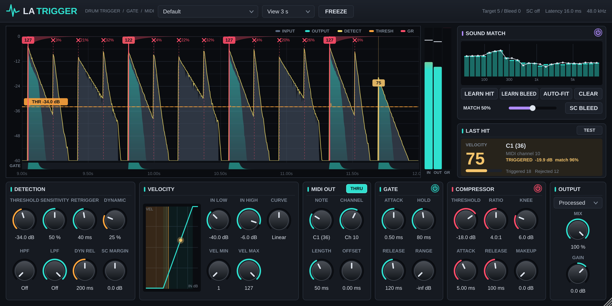

# LA-Trigger

A drum trigger plugin for Linux, Windows and macOS. It detects drum hits on an audio track
and sends them as MIDI notes with velocity to any instrument in your DAW. It can also gate and
compress the source track using those same hits.

| Platform | Formats |
|---|---|
| Windows 10/11 (x64) | VST3 |
| macOS 10.13+ (Apple silicon and Intel) | VST3, AU |
| Linux (x86_64) | VST3, LV2, Standalone |

Ready-to-install builds for all three are on the [Releases](https://github.com/AzoghMartins/LA-Trigger/releases) page.



## Features

| Area | What it does |
|---|---|
| **Transient detection** | Threshold, *Sensitivity* (how sharp an attack must be), *Retrigger* dead-time against flams/double hits, 24 dB/oct detection HPF/LPF to focus on one drum. |
| **Dynamic threshold** | After each hit the threshold jumps up and decays (*Dynamic*, *Dyn Rel*). This rejects ringing toms and bleed right after loud hits. |
| **Sound Match (learn)** | Learn the target drum and optionally the bleed (hi-hat, other drums). Each hit's spectral fingerprint is compared with the learned sounds, and only matching hits trigger. The learned profiles are saved with your session. |
| **Sidechain bleed reject** | Feed a neighbouring mic (e.g. the hi-hat mic) to the sidechain input. Hits that are louder there than on the main input by more than the *SC Margin* are rejected. |
| **Velocity** | Input level window (*In Low / In High*) mapped to a velocity range (*Vel Min / Vel Max*) through a curve, with a live transfer graph. *Auto-Fit* sets threshold and range from the learned hits. |
| **MIDI out** | Choose the note, channel, note length and timing offset (±5 ms). Optional MIDI thru, plus a *Test* button to check your routing. |
| **Trigger gate** | Opens only on accepted hits, with lookahead so the transient is never cut. Attack / Hold / Release / Range. |
| **Compressor** | Threshold, Ratio, Knee, Attack, Release, Makeup on the gated signal. |
| **Output** | *Processed*, *Listen Detect* (hear the detection filter while tuning), or *MIDI Only*. Mix and output gain. |
| **Display** | 60 fps scrolling view of input, output, detection envelope, static and dynamic thresholds, gate and gain reduction. Hits show their velocity, and rejected hits show their match score. Drag the threshold line directly, use the mouse wheel to zoom, and Freeze to inspect. |
| **Presets** | Kick In, Kick Out/Sub, Snare Top/Bottom, Rack/Floor Tom, Overheads→Kick, Live/Tight Gate. |

### Timing and latency

The plugin looks about 10 ms past each transient so it can measure the true peak (for velocity)
and fingerprint the sound before deciding. It reports **16 ms of latency** at 44.1/48 kHz, and the
DAW's delay compensation then places MIDI notes and gated audio exactly on the original
transient. Make sure plugin delay compensation is enabled in your DAW.

## Using it

1. Insert LA-Trigger on the drum track (e.g. snare top).
2. Create an instrument track (drum sampler) and route LA-Trigger's **MIDI output** to it:
   - **Reaper**: on the instrument track, add a receive from the drum track with *Audio: None*
     and *MIDI: All*. Alternatively, set the drum track's *MIDI hardware output* / send.
   - **Bitwig**: set the instrument track's input to the drum track. Choosing *Note* lets
     plugin MIDI pass through.
   - **Ardour**: connect the plugin's MIDI out port in the routing grid (enable it in the plugin
     pin configuration).
3. Pick a preset, then drag the orange threshold line just above the noise and bleed.
4. Optional: press **LEARN HIT**, play a few hits of the drum, then press it again. Do the same
   with **LEARN BLEED** on other drums or hi-hat. Enable **Sound Match** (the power button).
5. Press **AUTO-FIT** to set the velocity range from your playing. Adjust *Vel Min/Max* and
   *Curve* to taste.
6. Set the Gate and Compressor, or choose *MIDI Only* to silence the source.

## Building

### Linux

```bash
sudo apt install build-essential cmake ninja-build libasound2-dev libx11-dev libxrandr-dev \
  libxinerama-dev libxcursor-dev libxext-dev libfreetype-dev libfontconfig1-dev libgl1-mesa-dev

cmake -B build -G Ninja -DCMAKE_BUILD_TYPE=Release        # downloads JUCE 8 automatically
cmake --build build -j
xvfb-run -a ctest --test-dir build --output-on-failure    # optional: run the tests

# install
mkdir -p ~/.vst3 ~/.lv2
cp -r build/LATrigger_artefacts/Release/VST3/LA-Trigger.vst3 ~/.vst3/
cp -r build/LATrigger_artefacts/Release/LV2/LA-Trigger.lv2 ~/.lv2/
```

Options:
- `-DLATRIGGER_JUCE_DIR=/path/to/JUCE` uses a local JUCE checkout.
- `-DLATRIGGER_COPY_AFTER_BUILD=ON` installs the plugins automatically.

### Windows

Needs Visual Studio 2022 (the "Desktop development with C++" workload) and CMake 3.22 or newer.

```powershell
cmake -B build -G "Visual Studio 17 2022" -A x64          # downloads JUCE 8 automatically
cmake --build build --config Release --parallel
ctest --test-dir build -C Release --output-on-failure       # optional: run the tests
```

Install by copying `build\LATrigger_artefacts\Release\VST3\LA-Trigger.vst3` into `C:\Program Files\Common Files\VST3`.

### macOS

Needs Xcode (or the Command Line Tools) and CMake 3.22 or newer. The build is a universal binary
(Apple silicon and Intel) and runs on macOS 10.13 or newer.

```bash
cmake -B build -DCMAKE_BUILD_TYPE=Release                   # downloads JUCE 8 automatically
cmake --build build --parallel
ctest --test-dir build --output-on-failure                  # optional: run the tests

# install
cp -R build/LATrigger_artefacts/Release/VST3/LA-Trigger.vst3 ~/Library/Audio/Plug-Ins/VST3/
cp -R build/LATrigger_artefacts/Release/AU/LA-Trigger.component ~/Library/Audio/Plug-Ins/Components/
```

### Downloads

GitHub Actions builds every push on Linux, Windows and macOS and uploads ready-to-install archives as
artifacts. Tagged releases carry all three:

- `LA-Trigger-linux-x86_64.tar.gz`: VST3, LV2 and Standalone. Copy them into `~/.vst3` and `~/.lv2`.
- `LA-Trigger-windows-x64.zip`: VST3. Extract it into `C:\Program Files\Common Files\VST3`.
- `LA-Trigger-macos-universal.zip`: VST3 and AU. Copy them into `~/Library/Audio/Plug-Ins/VST3` and
  `~/Library/Audio/Plug-Ins/Components`. The plugins are not notarized, so after downloading, clear the
  quarantine flag once before starting your DAW:
  `xattr -dr com.apple.quarantine ~/Library/Audio/Plug-Ins/VST3/LA-Trigger.vst3 ~/Library/Audio/Plug-Ins/Components/LA-Trigger.component`

## Project layout

```
Source/dsp/TriggerEngine.*   detection, sound match, velocity, MIDI scheduling, gate, compressor (no JUCE dependency)
Source/Parameters.*          parameter layout and factory presets
Source/PluginProcessor.*     JUCE processor, buses (main + bleed sidechain), state, lock-free UI queues
Source/gui/                  look and feel, knobs, real-time displays, editor
tests/EngineTests.cpp        DSP tests on synthesized kick/snare/hat
tests/PluginIntegrationTest  drives processor + editor like a host; can render a screenshot
```

## License note

LA-Trigger is built on [JUCE 8](https://juce.com), which is dual-licensed under AGPLv3 or a
commercial license. Distributing builds requires either releasing this code under AGPLv3 or
holding a JUCE commercial license.
